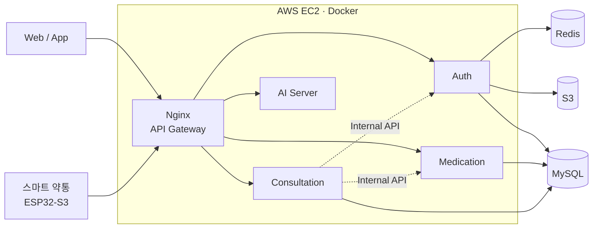

# MediNote

> 안전한 데이터 관리와 실시간 상담을 지원하는 AI 복약 관리 플랫폼

- **기간**: 2026.05.10 ~ 2026.06.18 (6주) · IBM AI 부트캠프 팀 프로젝트
- **팀 구성**: 3인 (백엔드 1, AI 1, 프론트엔드 1)
- **담당**: 백엔드 전반 · 보안/인증 설계 · 배포 인프라

<br>

## 주요 기능

| 기능 | 설명 |
|---|---|
| 회원 / 권한 | 사용자·약사·관리자 3계층 권한, JWT + Refresh Token, 소셜 로그인, SMS·이메일 인증 |
| 약사 승인 | 약사 면허증을 S3에 업로드하고 관리자 승인 후 활동 |
| 약사 1:1 상담 | WebSocket(STOMP) 실시간 채팅, 상담 종료 시 AI 요약 |
| 처방전 OCR | 처방전·약봉투 사진을 인식해 복약 일정 자동 생성 |
| AI 챗봇 | 복용 중인 약과 건강 정보를 바탕으로 복약 질문에 답변 |
| 스마트 약통 | ESP32-S3 센서로 복약 여부를 감지해 기록 |

<br>

## 아키텍처



- 기능별로 서버를 나눈 구조이며, 외부 요청은 모두 **Nginx API Gateway**를 거칩니다.
- 서버 간 통신은 `/api/internal/**` 내부 API로 하고, 이 경로는 게이트웨이에서 외부 접근을 차단합니다.

<br>

## 기술 스택

| 구분 | 기술 |
|---|---|
| Backend | Java 21, Spring Boot, Spring Security, Spring Data JPA, WebSocket(STOMP) |
| Database | MySQL, Redis |
| Infra | AWS (EC2, S3), Docker, Nginx, GitHub Actions |
| AI (팀원) | Python, FastAPI, OpenAI, Qdrant |
| Frontend (팀원) | React, TypeScript, Expo |

<br>

## 핵심 역할

### 1. 보안 및 인증 아키텍처 설계
- Spring Security와 JWT로 **사용자·약사·관리자 3계층 권한** 제어
- Refresh Token은 Redis에 TTL과 함께 저장해 만료를 자동 관리
- OAuth2 소셜 로그인, SMS·이메일 인증, 약사 면허 승인 흐름 구현

### 2. 실시간 1:1 약사 상담 서버
- **STOMP 기반 Pub/Sub** 채팅 서버 구현
- `ChannelInterceptor`로 STOMP CONNECT 시점에 **JWT를 사전 검증**하고, 상담방 참여자만 구독할 수 있도록 제한
- 메시지를 브로드캐스트하기 전에 **DB에 먼저 저장**해, 인메모리 브로커의 휘발성과 상관없이 대화 내역을 보존

```
연결·구독      클라이언트 CONNECT (JWT 검증) → 채팅방 Topic 구독 (참여자 검증)
발행·처리      메시지 발송 → DB 우선 저장
브로드캐스트   Message Broker → 구독자에게 실시간 Push
```

### 3. 민감 의료 데이터 암호화
- **JPA `@Convert`** 로 비즈니스 로직 수정 없이 저장·조회 시점에 자동으로 암복호화 (AES-GCM)
- 양방향 암호화 컬럼은 검색이 불가능한 한계를 **단방향 해시 컬럼(`emailHash`)** 을 함께 저장해 해결 → 보안과 조회를 동시에 확보

```
비즈니스 로직 (평문 객체) → JPA @Convert (자동 암복호화) → MySQL (암호문 + 해시 컬럼)
```

### 4. 멀티 서버 배포
- Nginx를 API Gateway로 두고, 기능별로 분리된 서버를 Docker 컨테이너로 AWS EC2에 배포
- **GitHub Actions → ECR → EC2** 자동 배포 파이프라인 구성

<br>

## 트러블슈팅

### 공유 DB 환경에서 `ddl-auto=create`로 인한 연쇄 장애
**상황** Auth·상담·복약 서버가 하나의 DB를 공유하는 구조에서, Auth 서버 설정의 `ddl-auto=create` 때문에 배포 시 전체 스키마가 초기화되었고 다른 서버까지 함께 장애가 발생했습니다.

**원인** JPA 스키마 자동 생성 옵션이 분산 환경 전체에 미치는 영향을 간과했습니다.

**해결 및 배운 점**
- 설정을 즉시 되돌리고 스키마를 수동으로 복구해 서비스를 정상화했습니다.
- 운영 환경에서는 Flyway 같은 마이그레이션 도구로 스키마 버전을 엄격하게 관리해야 한다는 것을 체감했습니다.

<br>

## 수료 후 리팩토링

| 발견한 문제 | 개선 |
|---|---|
| 관리자 전체 회원·승인 대기 약사 조회 시 연관 엔티티(`UserProfileHealth`, `UserChronicDisease`, `PharmacistProfile`) 반복 조회로 **N+1 쿼리** 발생 | `JOIN FETCH` (`findAllWithDetails`, `findPendingPharmacistsWithProfile`)를 적용해 단건 쿼리로 최적화 |
| 일부 서비스(`AdminService`, `AuthService`)에서 `RuntimeException`을 직접 던져 500 에러가 노출되고 예외 규격이 불일치 | `@RestControllerAdvice` + `ErrorCode` Enum 기반 `CustomException`으로 글로벌 예외 처리 규격(`ErrorResponse`) 통일 및 필드 순서 버그 수정 |
| 역할만 확인해서 다른 약사도 환자 정보를 조회할 수 있음 | 해당 상담방의 담당 약사만 조회 가능 (그 외 403) |
| 메시지 발신자 정보를 클라이언트가 직접 보내 위조 가능 | 발신자를 JWT 기준으로 설정 |
| 내부 API가 게이트웨이를 통해 외부에 노출 | Nginx에서 `/api/internal/` 차단 |
| Nginx와 Spring의 업로드 한도가 서로 달라 원인 파악이 어려움 | 15MB로 통일, 초과 시 413 응답 |
| S3 이미지 삭제가 실제로 호출되지 않음 | 삭제 호출 추가 |

JUnit 5 단위 테스트(`AdminServiceTest`, `GlobalExceptionHandlerTest`, `StompAuthChannelInterceptorTest`, `ConsultationServicePatientInfoTest` 등)를 작성하고, Docker로 전체 백엔드를 띄워 실제 요청을 검증했습니다.

<br>

## 프로젝트 구조

```
├── backend-auth/           # 인증·회원·권한 (Spring Boot)
├── backend-medication/     # 복약 일정·약 정보 (Spring Boot)
├── backend-consultation/   # 약사 상담·챗봇 (Spring Boot)
├── ai-server/              # OCR·챗봇·상담 요약 (FastAPI)
├── frontend/               # 웹 (React)
├── mobile-expo/            # 앱 (Expo)
├── smartpill/              # 스마트 약통 (ESP32-S3)
├── infra/nginx/            # API Gateway 설정
└── .github/workflows/      # 배포 자동화
```

<br>

## 팀

| 이름 | 역할 |
|---|---|
| 하윤주 | 백엔드 |
| 팀원 1 | 프론트엔드 |
| 팀원 2 | AI |
